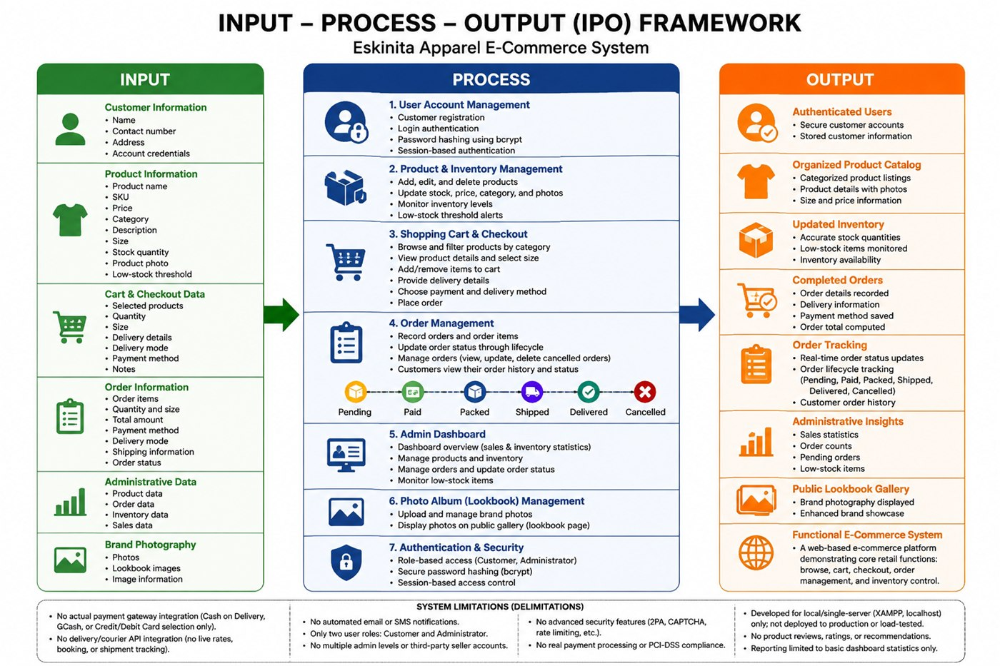

# Eskinita Apparel: Inventory and Online Ordering System

A web-based e-commerce system for **Eskinita Apparel**, a local streetwear brand. Customers can browse products and place orders online, while the admin manages inventory and orders.

> Team capstone project for BSIT at Datamex College of Saint Adeline.
> Full title: *"Development of an Inventory and Online Ordering System for a Local Streetwear Business: The Case of Eskinita Apparel"*

## Problem

Small local apparel businesses often track stock and orders by hand. This can cause wrong stock counts, slow order processing, and mistakes.

## Objectives

- Track product stocks accurately
- Give customers an online ordering platform
- Keep products, orders, and sales in one database

## Features

| Module | What it does |
|---|---|
| User accounts | Customer sign-up and login with hashed passwords (bcrypt) |
| Product catalog | Products with price, size, stock, category, and photo; low-stock alerts |
| Cart and checkout | Add to cart, choose size, enter delivery details and payment method |
| Order management | Order status: Pending, Paid, Packed, Shipped, Delivered, Cancelled |
| Admin dashboard | Sales and inventory stats, manage products and orders |
| Lookbook | Photo gallery of the brand |

## Technologies

- **Frontend:** HTML, CSS, JavaScript
- **Backend:** Node.js with Express.js
- **Database:** MySQL (XAMPP)

## Results

The system was evaluated by **200 survey respondents**, and the results were generally positive for its interface, ordering process, stock tracking, and usefulness.

## Limitations

- No real payment gateway (payment method is recorded only)
- No courier integration or email/SMS notifications
- Tested only on a local server (localhost)

## Team

Bermudez, Marc Jayr (Leader) · Soreda, Rovilyn Shaine (Assistant Leader) · Albero, Prince Carl · Alipio, Rachelle · **Flores, Sherry Mae** · Sore, Bianca Nicole · Vanzuela, Mark Ian
